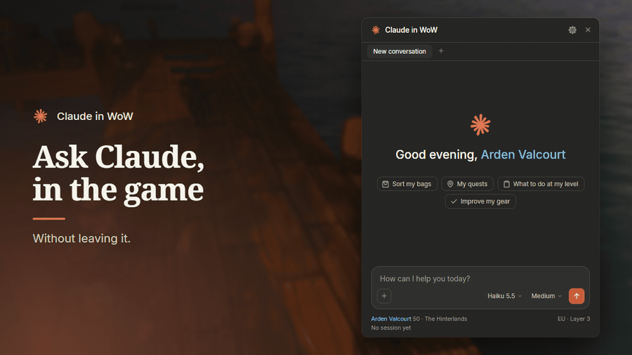
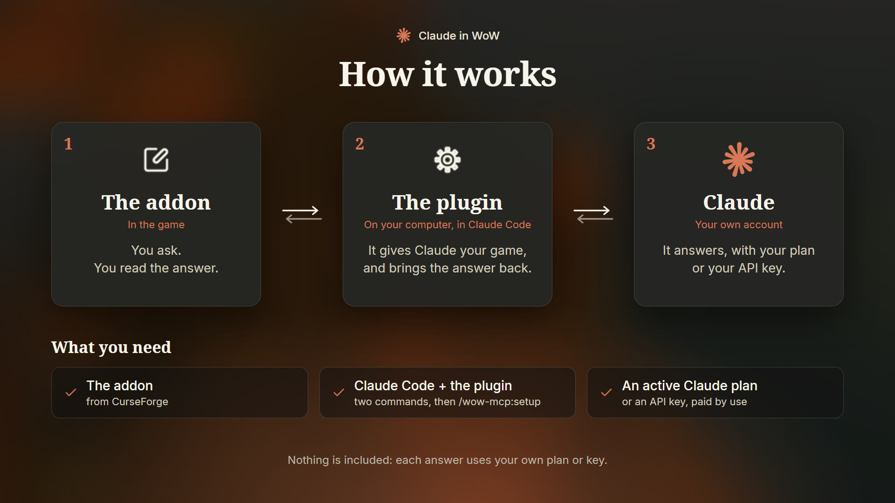

# Claude in WoW

<!-- with the first release:

-->
<!-- once the CurseForge project exists:  -->

Posez à [Claude](https://claude.com) vos questions sur votre partie de World of Warcraft, **depuis le jeu** : votre personnage, vos quêtes, vos sacs, où aller et pourquoi. La réponse s'affiche dans une fenêtre du jeu, avec ses liens, ses boutons, ses marques sur vos sacs et ses itinéraires.

**Non officiel.** Fonctionne avec Claude, d'Anthropic. Sans lien avec Anthropic ni Blizzard.

Il y a deux parties, qui vont ensemble :

- **l'addon** (`addon/`), dans le jeu : la fenêtre, ce qui est lu du jeu, ce qui est affiché. Retail, les versions Classic et WoW Forever, en anglais, français, allemand, espagnol et italien ;
- **le plugin** (`plugin/`), sur votre ordinateur : un plugin de [Claude Code](https://claude.com/claude-code) qui reçoit vos questions, donne à Claude l'état de votre partie et met les réponses dans le jeu.

Il ne fait que proposer. Il ne joue jamais à votre place : un clic, une action, et rien de ce qui fait perdre quelque chose n'a de bouton.

## L'installer

1. Installez [Claude Code](https://claude.com/claude-code) et connectez-vous avec votre compte Claude (un forfait actif : Pro, Max...). Pas de forfait ? Une clé API à vous marche aussi, payée à l'usage : l'étape 4 dit comment.
2. Mettez l'addon dans le dossier `Interface\AddOns` du jeu, sous le nom `claude-in-wow`.
3. Dans Claude Code, tapez `/plugin marketplace add tomlrd/claude-in-wow`, puis `/plugin install wow-mcp@claude-in-wow`.
4. Tapez `/wow-mcp:setup` : tout est vérifié, [Node.js](https://nodejs.org) est proposé s'il manque, et les réponses sont lancées.
5. Quittez le jeu et relancez-le, une fois. Un clic sur l'étincelle de la mini-carte ouvre la fenêtre.

Chaque réponse utilise votre propre forfait Claude, ou votre clé API (gardée chiffrée sur votre ordinateur, donnée à Claude Code seulement). Les réponses arrivent même sans fenêtre Claude ouverte : un programme caché attend vos questions (le mode silencieux). Ou parlez à une session Claude que vous voyez : vous choisissez, dans les réglages de l'addon. Il marche sous Windows ; sous macOS il devrait, dites-nous.

## Ce qui est lu, et où ça va

Lu dans le jeu : votre personnage, vos quêtes, vos sacs, les lieux et les gens autour, la liste de vos addons et leurs erreurs Lua, et ce dont une question a besoin. **Jamais** : les chuchotements, Battle.net, le canal et les notes des officiers, les réglages du compte. Votre question part au plugin dans une capture d'écran qui ne contient que ces données, que le plugin lit sur votre ordinateur, et supprime quand une autre la remplace ; Claude reçoit alors la question et ce qu'il lui faut. En plus, seul le web est interrogé : les recherches de Claude, et les noms d'objets, de quêtes ou de créatures d'une réponse, cherchés pour en faire des liens (jamais ceux des joueurs). Vous pouvez désactiver les deux. Une fois par jour, le plugin lit aussi la dernière version de ce projet sur GitHub, pour les mises à jour.

## Participer

Bugs, idées, traductions et code sont les bienvenus : [CONTRIBUTING.md](CONTRIBUTING.md), [TRANSLATING.md](TRANSLATING.md) (en anglais).

## Licence

[Tous droits réservés](LICENSE) (en anglais). Le lire, le forker sur GitHub, le modifier pour proposer vos changements, l'utiliser pour vous : oui. Le publier ailleurs (CurseForge, Wago ou tout autre site) ou le vendre : pas sans autorisation. Les bibliothèques (`addon/Libs`) et les polices (`addon/Media/Fonts`) ont leurs propres licences.
