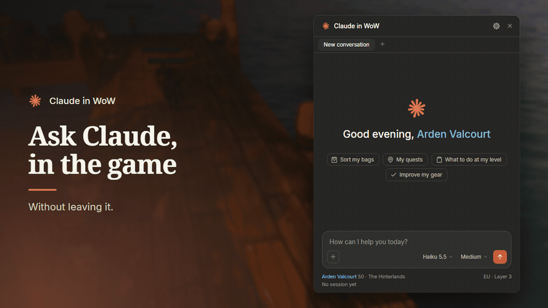
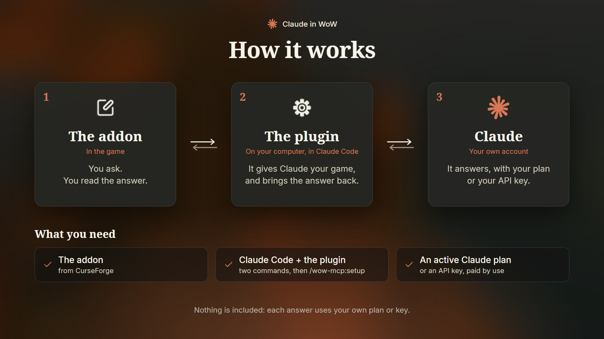

# Claude in WoW

Ask [Claude](https://claude.com) about your World of Warcraft game, **from the game itself**: your character, your quests, your bags, where to go and why. The answer shows in a window in the game, with its links, its buttons, its marks on your bags and its routes to follow.

**The addon: [on CurseForge](https://www.curseforge.com/wow/addons/claude-in-wow)** (or the zip of each [release](https://github.com/tomlrd/claude-in-wow/releases)).

**Unofficial.** Works with Claude, by Anthropic. Not affiliated with Anthropic nor Blizzard.

It is two things that go together:

- **the addon** (`addon/`), in the game: the window, what is read from the game, what is drawn. Retail, the Classic versions and WoW Forever, in English, French, German, Spanish and Italian;
- **the plugin** (`plugin/`), on your computer: a [Claude Code](https://claude.com/claude-code) plugin that receives your questions, gives Claude the state of your game, and puts the answers in the game.

It only proposes. It plays nothing in your place: one click is one action, and nothing that loses something has a button.

## Installing it

1. Install [Claude Code](https://claude.com/claude-code) and sign in with your Claude account (an active plan: Pro, Max...). No plan? An API key of yours works too, paid by use: step 4 tells how.
2. Install the addon from [CurseForge](https://www.curseforge.com/wow/addons/claude-in-wow), or put the zip of a [release](https://github.com/tomlrd/claude-in-wow/releases) in the game's `Interface\AddOns` folder.
3. In Claude Code, type `/plugin marketplace add tomlrd/claude-in-wow`, then `/plugin install wow-mcp@claude-in-wow`.
4. Type `/wow-mcp:setup`: it checks everything, offers to install [Node.js](https://nodejs.org) when it is missing, and starts the answers.
5. Quit the game and start it again, once. A click on the spark on the minimap opens the window.

Each answer uses your own Claude plan, or your API key (kept encrypted on your computer, given to Claude Code alone). The answers come even with no Claude window open: a hidden program waits for your questions (the silent mode). Or talk to a Claude session you see: you choose, in the addon's settings. It works on Windows; on macOS it should, tell us how it goes.

## What is read, and where it goes

Read in the game: your character, quests, bags, the places and people around, your addons' list and Lua errors, and what a question needs. **Never**: whispers, Battle.net, officers' chat and notes, your account's settings. Your question goes to the plugin in a screenshot that only holds that data, which the plugin reads on your computer, and deletes once another replaces it; Claude then gets the question and what it needs of it. Besides that, only the web is asked: the searches Claude makes, and the names of items, quests or creatures in an answer, looked up to make them links (never those of players). You may turn both off. Once a day the plugin also reads this project's last release on GitHub, for the updates.

How the two parts talk: [docs/protocol.md](docs/protocol.md).

## Taking part

Bugs, ideas, translations and code are welcome: [CONTRIBUTING.md](CONTRIBUTING.md), [TRANSLATING.md](TRANSLATING.md).

## License

[All rights reserved](LICENSE). Read it, fork it on GitHub, change it to propose your changes, use it for yourself: yes. Publish it elsewhere (CurseForge, Wago or any other site) or sell it: not without permission. The embedded libraries (`addon/Libs`) and fonts (`addon/Media/Fonts`) have their own licenses.
